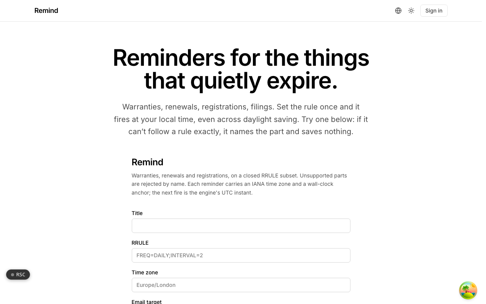
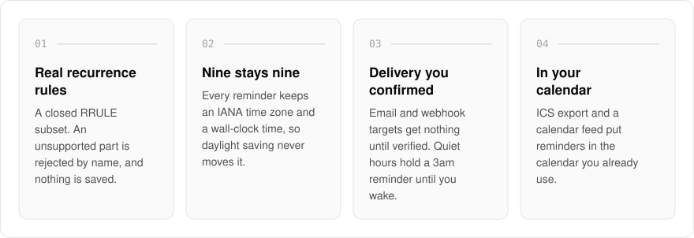
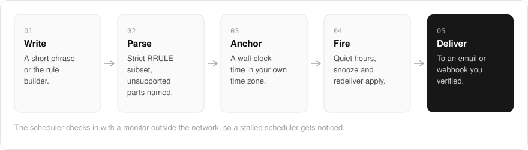

  <picture>
    <source media="(prefers-color-scheme: dark)" srcset=".github/assets/hero-dark.png">
    
  </picture>

<h1 align="center">remind.me.at</h1>

<strong>Reminders for the things that quietly expire.</strong>

  
  
  

  <a href="#features">Features</a> ·
  <a href="#how-it-works">How it works</a> ·
  <a href="#built-with">Built with</a>

Warranties, renewals, registrations and filings expire on dates nobody is watching, and most reminder apps fail them quietly: a rule they half understand, or an alarm that slips an hour at daylight saving. I built remind.me.at to be strict on purpose. Set the rule once and it fires at your local time, every time, with delivery to a channel you already read. If it cannot follow a rule exactly, it names the unsupported part and saves nothing.

  <picture>
    <source media="(prefers-color-scheme: dark)" srcset=".github/assets/overview-dark.svg">
    
  </picture>

## Why remind.me.at

| The usual reminder app | remind.me.at |
| --- | --- |
| Guesses at a rule it cannot follow | Names the unsupported part and saves nothing |
| Slips an hour at daylight saving | Keeps a wall-clock time in your IANA time zone |
| Sends to whatever address you typed | Delivers only to targets you confirmed |
| Stops working without anyone noticing | Checks in with a monitor outside the network |

## Features

- **Real recurrence rules**: a closed RRULE subset (`FREQ`, `INTERVAL`, `BYDAY`, `UNTIL`, `COUNT`), with unsupported parts rejected by name.
- **Time-zone aware**: every reminder stores an IANA time zone and a wall-clock time, so "09:00 every Monday" stays at nine across daylight saving.
- **Phrase entry and a rule builder**: write a reminder in a small, closed grammar or build the rule visually. Both produce the same RRULE subset.
- **Verified delivery**: email or webhook targets that receive nothing until they are confirmed.
- **Quiet hours, snooze and redeliver**: a reminder due at 3am can wait until you are awake.
- **Calendar export**: ICS export and a calendar feed, so reminders show up in the calendar you already use.
- **Fire history**: each reminder keeps a record of when it fired.
- **Heartbeat monitoring**: the scheduler checks in with a monitor outside the network, so a stalled scheduler gets noticed.

## How it works

  <picture>
    <source media="(prefers-color-scheme: dark)" srcset=".github/assets/flow-dark.svg">
    
  </picture>

You write a reminder as a short phrase or build it in the rule builder, and both become the same strict RRULE subset; anything outside it is named and refused. Each reminder is anchored to a wall-clock time in its own IANA time zone, so daylight saving never moves it. When it fires, quiet hours and snooze apply, and it is delivered only to an email or webhook target you verified.

## Built with

  
  
  
  
  

- Next.js 16 (App Router) and React 19
- TypeScript
- Tailwind CSS 4
- iCalendar (ICS) export
- Better Auth (shared me.at account)

## Part of the me.at family

remind.me.at is one of my [`*.me.at`](https://me.at) apps. They share one design system, account, and app shell. Development happens in a private monorepo; this repository is the project's public-facing home.

## License

Source-available. See [LICENSE](LICENSE).
